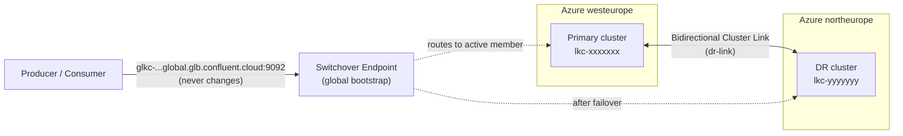
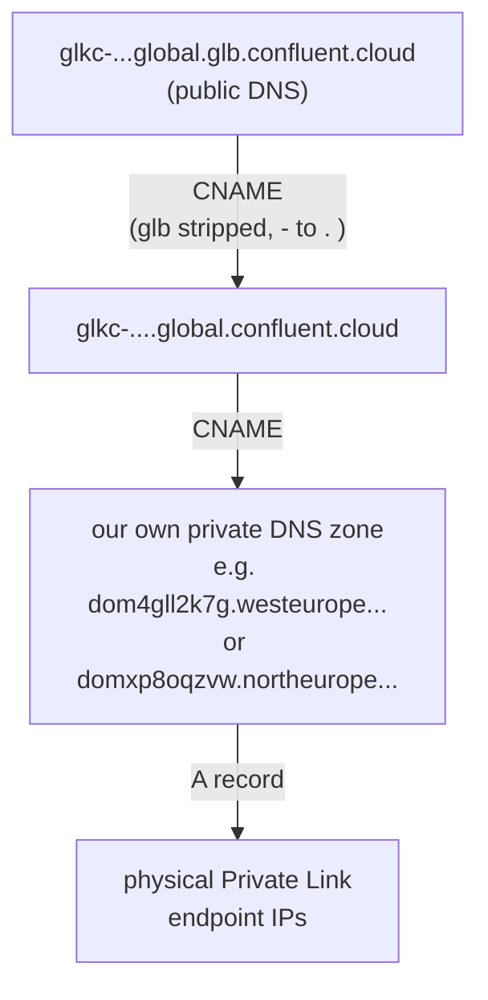
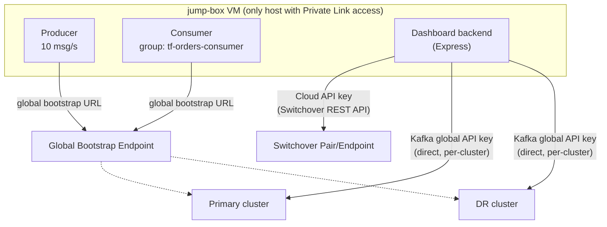

# Transparent Failover
## on Confluent Cloud

Disaster recovery without client reconfiguration

<div class="pt-12 text-sm opacity-60">
Azure Private Link &middot; Cluster Linking &middot; DR Automatic Failover (Early Access)
</div>

<!--
Welcome / intro slide. Set expectations: this is a technical deep-dive, we'll end with a live demo.
-->

---
layout: center
---

# Agenda

<div class="grid grid-cols-2 gap-8 text-left pt-4">
<div>

**The problem**
1. Why DR matters for streaming
2. The traditional DR tax

**The architecture**
3. Private Link to both regions
4. Cluster Linking
5. Switchover Pair & Endpoint
6. The global bootstrap URL

</div>
<div>

**What actually happens**
7. Failover, step by step
8. What we measured

**Live demo**
9. Architecture recap
10. Trigger a real failover

**Wrap-up**
11. Lessons learned
12. Q&A

</div>
</div>

---

# Why DR matters for streaming

A regional outage doesn't just take your cluster offline — it takes your **event-driven
architecture** offline. Every downstream consumer, every stream processor, every system that
reacts to real-time data stalls at the same time.

<v-clicks>

- **RPO** (data loss tolerance) — how much data can you afford to lose?
- **RTO** (recovery time) — how long can production stay down?
- Kafka already replicates *within* a region (3x replication, rack awareness) — that doesn't
  help when the **region itself** is the failure domain
- Cross-region replication (Cluster Linking) solves the *data* problem — but doesn't by itself
  solve the *client reconnection* problem

</v-clicks>

<!--
Set up the motivation before diving into mechanics.
-->

---

# The traditional DR tax

Even with data mirrored to a second region, classic Kafka DR still costs you:

<v-clicks>

- **Manual cutover** — someone has to notice the outage, decide to fail over, and execute a runbook
- **Client reconfiguration** — every producer and consumer needs a new bootstrap address, a
  config push, a redeploy
- **Coordination risk** — if some clients cut over before others, you get split-brain writes
- **Failback is a second, separate manual operation** — and often gets skipped because it's risky

<div class="pt-4 text-xl font-semibold text-orange-400">
What if the client config never had to change at all?
</div>

</v-clicks>

---
layout: section
---

# The architecture

---

# What we built

Two **Dedicated** Kafka clusters, one per region, connected by Azure Private Link and a
bidirectional Cluster Link, fronted by a single **global bootstrap URL**.



Every component below exists to make that single arrow — client to global endpoint — true no
matter which region is actually serving traffic.

---

# Private Link to both regions

Each region gets its own Confluent Cloud **network** (classic Private Link model — required for
Dedicated clusters) with **3 zonal private endpoints**, landing in our own Azure VNets.

<div class="grid grid-cols-2 gap-6 pt-4 text-sm">
<div>

**westeurope (primary)**
- VNet `10.20.0.0/16`
- 3 zonal Private Endpoints → `10.20.1.4/5/6`
- Private DNS zone matches the network's own `dns_domain`
- Bootstrap: `lkc-xxxxxxx.<dns_domain>.westeurope.azure.confluent.cloud:9092`

</div>
<div>

**northeurope (DR)**
- VNet `10.21.0.0/16`
- 3 zonal Private Endpoints → `10.21.1.4/5/6`
- Private DNS zone matches its own `dns_domain`
- Bootstrap: `lkc-yyyyyyy.<dns_domain>.northeurope.azure.confluent.cloud:9092`

</div>
</div>

<div class="pt-6 text-sm opacity-75">
VNets are peered, and <b>both</b> private DNS zones are linked to <b>both</b> VNets — so a single
jump-box VM (or, in production, a single client network) can resolve and reach either cluster.
</div>

---

# Cluster Linking: the data path

A single **bidirectional** Cluster Link (`dr-link`) mirrors topics in both directions —
whichever side is "active" has the writable copy; the other side gets an auto-created mirror.

```yaml
link.mode=BIDIRECTIONAL
auto.create.mirror.topics.enable=true
auto.create.mirror.topics.filters={"topicFilters":[{"name":"*","patternType":"LITERAL","filterType":"INCLUDE"}]}
consumer.offset.sync.enable=true    # consumer group offsets follow the data
acl.sync.enable=true                # RBAC/ACLs stay in sync too
```

<v-clicks>

- Wildcard topic filter → **any new topic gets mirrored automatically**, no per-topic setup
- Consumer offset sync means a consumer that reconnects on the DR side **resumes where it left
  off** — no reprocessing, no gaps
- This link is **always running**, continuously, independent of whether a failover ever happens

</v-clicks>

---

# Switchover Pair & Endpoint

Two small control-plane resources turn "a cluster link exists" into "clients can fail over":

<div class="grid grid-cols-2 gap-6 pt-4">
<div>

**Switchover Pair**
```bash
confluent switchover pair create \
  --member name=primary,crn=.../cloud-cluster=lkc-xxxxxxx \
  --member name=secondary,crn=.../cloud-cluster=lkc-yyyyyyy \
  --active-member primary
```
Tracks *which* cluster is currently active.
Phases: `PROVISIONING` → `READY_TO_FAILOVER`

</div>
<div>

**Switchover Endpoint**
```bash
confluent switchover endpoint create \
  --parent-resource-crn .../switchover-pair=sw-... \
  --endpoint name=primary-ep,type=private,network=.../network=n-xxxxx \
  --endpoint name=secondary-ep,type=private,network=.../network=n-yyyyy
```
Issues the **global bootstrap URL** and wires it to each region's Private Link network.

</div>
</div>

<div class="pt-6 text-sm opacity-75">
For <b>Dedicated</b> clusters, the endpoint references a Private Link <code>network=</code> CRN
directly. (Enterprise clusters use a different, gateway/access-point-based model — see the
appendix.)
</div>

---

# The global bootstrap URL

`glkc-<pair-id>-<endpoint-id>.global.glb.confluent.cloud:9092` — one address, for the
life of the client.



<v-clicks>

- The **first two hops are public DNS**, resolved from anywhere
- The **last hop only resolves inside the customer's own VNet** — because it's *our* private
  zone — which is exactly what keeps this private-link-only
- When a failover happens, **Confluent repoints which private zone that final CNAME lands on** —
  the client never re-resolves anything differently; it just gets a different answer

</v-clicks>

---

# Failover, step by step

<div class="text-sm">

1. **Trigger** — `POST /switchover/v1/switchover-pairs/{id}:failover` with
   `{"spec": {"active_member": "secondary", "failover_type": "PLANNED"}}`
2. Pair phase → `UPDATING`
3. Confluent re-points the global endpoint's DNS chain to the DR region's Private Link network
4. **In-flight client connections to the old active cluster start failing** — this is the
   visible "halt"
5. The DR cluster's mirror topic is **promoted to a regular, writable topic**; the primary's
   topic becomes the mirror — **the Cluster Link's effective direction reverses**
6. Clients using the global bootstrap URL **reconnect automatically** (standard Kafka client
   retry/reconnect behavior — no special client support needed) and resume
7. Consumer picks up from its **last committed offset**, synced via the link — no gaps, no
   reprocessing
8. Pair phase → `READY_TO_FAILOVER` again, now with `active_member: secondary`

</div>

<div class="pt-4 text-lg font-semibold text-orange-400">
Steps 4-6 are the entire blast radius. Nothing about the client changes.
</div>

---

# What we measured

Running our own producer (10 msg/s) and consumer against the global bootstrap URL, we triggered
real failovers and failbacks (not a simulation):

<div class="grid grid-cols-3 gap-4 pt-6">
<div class="p-4 rounded-lg bg-blue-500/10 border border-blue-500/30">
<div class="text-sm opacity-70">Cutover duration</div>
<div class="text-3xl font-bold">~25-60s</div>
<div class="text-xs opacity-60">button click → traffic resumed</div>
</div>
<div class="p-4 rounded-lg bg-green-500/10 border border-green-500/30">
<div class="text-sm opacity-70">Message loss</div>
<div class="text-3xl font-bold">Zero</div>
<div class="text-xs opacity-60">producer sent == consumer received, every run</div>
</div>
<div class="p-4 rounded-lg bg-purple-500/10 border border-purple-500/30">
<div class="text-sm opacity-70">Client changes required</div>
<div class="text-3xl font-bold">None</div>
<div class="text-xs opacity-60">same bootstrap URL, same credentials</div>
</div>
</div>

<div class="pt-8 text-sm opacity-75">
We verified the cutover <i>independently</i> of the Switchover API's own status — our dashboard
calls <code>admin.describeCluster()</code> through the global URL and compares the returned
cluster ID, so we're observing the client's actual experience, not just trusting the control plane.
</div>

---
layout: section
---

# Live demo

---

# What you're about to see

<div class="grid grid-cols-2 gap-8 pt-4">
<div>

**The dashboard shows, live:**
- Producer & consumer status (running, sent/received counts)
- Which physical cluster is *actually* serving traffic right now
- Topic offsets and consumer-group committed offsets, both regions
- Cluster link direction
- A failover stopwatch

</div>
<div>

**Watch for:**
- The brief halt in production the moment we click the button
- The automatic reconnect — no config change, no redeploy
- The offset numbers on DR starting to move
- The stopwatch stopping the instant traffic is confirmed flowing again

</div>
</div>

<div class="pt-8 text-center text-lg">
Two buttons: <b>Trigger Failover</b> and <b>Fail Back</b> — this is fully repeatable.
</div>

---
layout: center
class: text-center
---

# 🔴 Live demo

### Trigger Failover → watch the dashboard

<!--
Switch to the browser here: http://<your-demo-vm-ip>/
-->

---

# Lessons learned building this

Things that surprised us along the way — included because they're genuinely useful if you're
evaluating this yourself:

<v-clicks>

- **Dedicated vs. Enterprise clusters use *completely different* Private Link models.** Dedicated
  uses the classic per-cluster, zonal `network` model; Enterprise uses a shared, SNI-routed
  Ingress Gateway/Access Point. Building for the wrong one looks like it works (resources go
  "READY") and then silently never connects.
- **Confluent intentionally fences direct data-plane access to the standby cluster** in a
  switchover pair — confirmed independently with two different Kafka clients. This isn't a bug;
  it's what forces every client through the transparent global endpoint in the first place.
- **The Switchover failover REST payload** is more specific than the CLI's own `--help` examples
  suggest (nested under `spec`, with `environment_crn` not `environment`) — found by tracing the
  CLI's own HTTP calls.
- A stuck Early-Access resource taught us the hard way to always confirm `metadata.updated_at` is
  actually advancing, not just that a resource "exists."

</v-clicks>

---
layout: center
class: text-center
---

# Questions?

<div class="pt-8 text-sm opacity-60">
Dashboard: http://<your-demo-vm-ip>/ &middot; Full build log and architecture notes in this
project's README.md and COMMANDS.md
</div>

---
layout: section
---

# Appendix

---

# Appendix: Enterprise vs. Dedicated Private Link

<table class="text-sm">
<thead>
<tr><th></th><th>Dedicated</th><th>Enterprise</th></tr>
</thead>
<tbody>
<tr><td>Networking model</td><td>Classic <code>network</code> resource, per-cluster</td><td>Shared Ingress PrivateLink Gateway + Access Point</td></tr>
<tr><td>Endpoints</td><td>3 zonal Private Endpoints per cluster</td><td>1 regional endpoint, shared across clusters/environments (SNI-routed)</td></tr>
<tr><td>DNS zone name</td><td>The network's own generated <code>dns_domain</code></td><td>The cluster's reported hostname suffix, e.g. <code>&lt;region&gt;.azure.private.confluent.cloud</code></td></tr>
<tr><td>Bootstrap hostname</td><td><code>lkc-id.&lt;dns_domain&gt;...</code></td><td><code>lkc-id.&lt;region&gt;.azure.private.confluent.cloud</code></td></tr>
<tr><td>Switchover endpoint CRN</td><td><code>network=n-xxxxx</code></td><td><code>access-point=ap-xxxxx</code></td></tr>
</tbody>
</table>

<div class="pt-6 text-sm opacity-75">
Regional ingress gateways are also quota-limited (1 per region per environment) and may already
be in use by another team — worth checking before assuming you can create one.
</div>

---

# Appendix: Producer/consumer architecture



Two distinct credential types: a **Kafka data-plane API key** (producer, consumer, offset
monitoring) and a separate **Cloud API key** with environment-admin scope (triggering failover) —
the Switchover Management API is a different surface entirely from the Kafka protocol.
